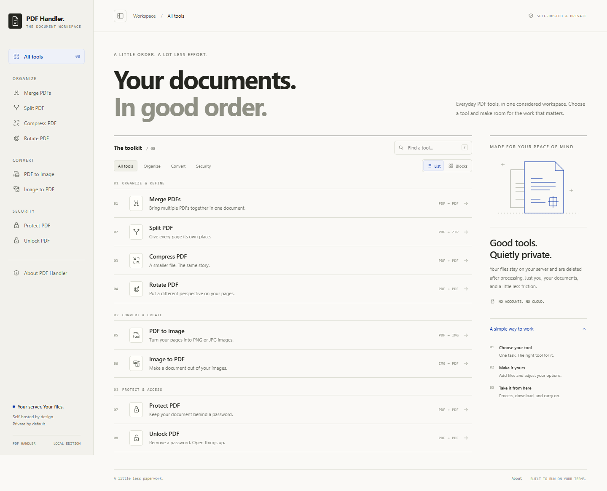

# PDF Handler

[](https://github.com/rafaelsilvabr/pdfHandler/actions/workflows/ci.yml)

A self-hosted PDF toolkit. One Go binary serves both the JSON API and a
self-contained web UI — no database, no object storage, no external service.
Files are processed in a temp directory and deleted when the response is sent.

Built for a homelab Kubernetes cluster, but it runs anywhere Docker does.



## Features

| Operation | What it does |
|---|---|
| **Merge** | Combine several PDFs into one |
| **Split** | Break a PDF into chunks of N pages, returned as a zip |
| **Compress** | Shrink a PDF at four quality levels (screen → prepress) |
| **Rotate** | Turn all pages or a selection by a multiple of 90° |
| **PDF → image** | Render pages to PNG or JPG at 72/150/300 dpi, returned as a zip |
| **Image → PDF** | Combine JPG/PNG/TIFF/WebP images into one PDF, one per page |
| **Protect** | Encrypt a PDF with a password |
| **Unlock** | Remove password protection |
| **Preview** | Page count plus base64 thumbnails, used by the UI |

The responsive workspace includes tool search (press `/`), category filters,
list and block layouts, keyboard-accessible page selection, and a compact
navigation menu on mobile. The top-bar toggle hides or restores the desktop
sidebar; layout and sidebar preferences are remembered in your browser.
The About page at `/about` explains the project, file handling, and license.
It uses a warm cream palette, fine borders, and International Klein Blue
(`#002FA7`) for actions and selection. SF Pro is used when installed, with native
system fonts as fallbacks. All fonts, icons and UI assets stay local; no CDN or
frontend build step is required. Motion respects reduced-motion preferences.

## Quick start

```bash
docker run --rm -p 8080:8080 r4faelrs/pdfhandler:latest
```

Open <http://localhost:8080>.

### Kubernetes

```bash
kubectl apply -f k8s/
```

This creates the `pdfhandler-ns` namespace, a Deployment, a NodePort Service on
`30880`, and an nginx Ingress for `pdf.home.lab`. Adjust the hostname and the
image tag in `k8s/deployment.yaml` to match your cluster.

### Building from source

Requires Go 1.25+, plus `ghostscript` and `poppler-utils` on `PATH`:

```bash
go build -o pdfhandler .
./pdfhandler
```

Or build the container, which bundles both tools:

```bash
docker build -t pdfhandler .
```

## Testing

Two layers, both run by [CI](.github/workflows/ci.yml) on every push and pull
request.

**Go tests** cover the handlers in isolation — the validation and rejection
rules, the zip and PDF output of each operation, and the middleware. Fixtures
are real PDFs built through pdfcpu at test time, so there are no binary blobs in
the repo. Tests that need ghostscript or poppler skip when those aren't
installed:

```bash
go test ./...
go test -race -cover ./...
```

**A functional smoke test** drives a running instance over HTTP and checks what
unit tests can't: the built container, its bundled tools, the response headers,
and the configured request body cap end to end.

```bash
docker build -t pdfhandler .
docker run -d --name pdfh -p 8080:8080 \
  --read-only --tmpfs /tmp --user 1001:1001 --cap-drop ALL pdfhandler
./scripts/smoke.sh http://127.0.0.1:8080
docker rm -f pdfh
```

CI runs the container under the same constraints the Kubernetes Deployment
applies — non-root, read-only root filesystem, all capabilities dropped — so a
change that quietly needs to write outside `/tmp` fails the build rather than
the cluster. `govulncheck` runs as a separate job.

## Configuration

| Variable | Default | Purpose |
|---|---|---|
| `PORT` | `8080` | Port to listen on |
| `MAX_UPLOAD_MB` | `100` | Maximum total upload request size in MiB (1 MiB = 1,048,576 bytes), including all files and multipart form overhead |
| `GIN_MODE` | `debug` | Set to `release` outside development |
| `HOME` | — | pdfcpu resolves its config dir from this; the image sets it to `/tmp` so it works as a non-root user |

Set the limit when starting the container, without rebuilding the image:

```bash
docker run --rm -p 8080:8080 -e MAX_UPLOAD_MB=250 pdfhandler
```

For Kubernetes, change `MAX_UPLOAD_MB` in `k8s/deployment.yaml`, or update an
existing Deployment (which rolls out new pods):

```bash
kubectl -n pdfhandler-ns set env deployment/pdfhandler MAX_UPLOAD_MB=250
kubectl -n pdfhandler-ns annotate ingress/pdfhandler-ingress \
  nginx.ingress.kubernetes.io/proxy-body-size=250m --overwrite
```

Keep the ingress or other reverse proxy's body limit at least as large as the
application limit; a smaller proxy limit rejects uploads before they reach the
app. Review memory and `/tmp` capacity when increasing it. Values must be positive
whole numbers; invalid or overflowing values prevent startup. Changes take effect
after a restart. The UI reads the active limit from `GET /api/config` and uses it
for the upload hints, About page, and file selection checks. UI labels use MB
for these binary units, matching the server's error messages.

## API

Operation endpoints take `multipart/form-data` and return the resulting file as
an attachment, except `/api/preview` (JSON). Configuration and health use GET.

| Endpoint | Form fields | Returns |
|---|---|---|
| `GET /api/config` | — | JSON: `maxUploadBytes` (active request body limit) |
| `POST /api/merge` | `files[]` (2–50 PDFs) | `merged.pdf` |
| `POST /api/split` | `file`, `span` (pages per chunk) | `split.zip` |
| `POST /api/compress` | `file`, `quality` (`screen`\|`ebook`\|`printer`\|`prepress`) | `compressed.pdf` |
| `POST /api/rotate` | `file`, `degrees` (multiple of 90), `pages` (`all` or `1,3,5-7`) | `rotated.pdf` |
| `POST /api/pdf-to-image` | `file`, `format` (`png`\|`jpg`), `dpi` (`72`\|`150`\|`300`) | `images.zip` |
| `POST /api/image-to-pdf` | `files[]` (1–100 images) | `output.pdf` |
| `POST /api/protect` | `file`, `password` | `protected.pdf` |
| `POST /api/unlock` | `file`, `password` | `unlocked.pdf` |
| `POST /api/preview` | `file`, `limit` (max 50) | JSON: page count + thumbnails |
| `GET /healthz` | — | `{"status":"ok"}` |

Errors come back as `{"error": "..."}` with a 4xx or 5xx status.

```bash
curl -F "files[]=@a.pdf" -F "files[]=@b.pdf" \
     -o merged.pdf http://localhost:8080/api/merge

curl -F "file=@big.pdf" -F "quality=screen" \
     -o small.pdf http://localhost:8080/api/compress
```

## Security

Every endpoint hands an untrusted file to ghostscript, poppler or pdfcpu, so
requests are narrowed before any of that runs:

- Uploads must start with the `%PDF-` magic bytes; image uploads must carry an
  allow-listed extension, derived from `filepath.Base` and pattern-matched
  rather than taken from `filepath.Ext` directly.
- Parameters are validated and rejected, not coerced.
- The request body is capped via `http.MaxBytesReader` (100 MiB by default,
  configurable with `MAX_UPLOAD_MB`); oversize
  uploads get a 413.
- Each ghostscript/poppler run is bounded by a 90 s timeout tied to the request
  context, and ghostscript runs with `-dSAFER`.
- Tool output and pdfcpu errors go to the log, never the response — they embed
  temp paths and fragments of the uploaded document.
- Responses carry a CSP and the usual hardening headers; `POST` responses are
  `no-store`.
- The container runs as a non-root user with a read-only root filesystem, all
  capabilities dropped, and no ServiceAccount token.

`go build` is checked against `govulncheck` — no known advisories reach this
code outside the standard library.

### Known limitations

- **No authentication.** Anyone who can reach the port can use it. Put it behind
  your ingress' auth, a VPN, or a trusted network.
- **The sample Ingress serves plain HTTP.** `/api/protect` and `/api/unlock`
  carry passwords in the request body, so terminate TLS before exposing it
  beyond a trusted LAN — `k8s/ingress.yaml` has a commented block for this.
- **No rate limiting.** Per-request timeouts and the CPU limit bound each job,
  but many concurrent compressions can still saturate a node.

## How it works

Gin routes both the API and the static UI from a single binary. Operations that
pdfcpu handles natively (merge, split, rotate, encrypt, image import) run
in-process; compression shells out to ghostscript and rasterisation to poppler's
`pdftoppm`, since neither has a good pure-Go equivalent.

See [DESIGN.md](DESIGN.md) for the reasoning behind those choices, the
alternatives considered, and the Kubernetes design.

```
main.go              Routing, middleware, server timeouts
handlers/            One file per operation; util.go holds the shared
                     validation, sandboxing and error helpers
static/index.html    Workspace markup and tool option panels
static/styles.css    Design tokens, responsive layouts and interaction states
static/app.js        Tool catalog, navigation, uploads, previews and processing
k8s/                 Namespace, Deployment, Service, Ingress
```

## Contributing

Issues and pull requests are welcome. This is a homelab project, so the bar is
"does it work and is it safe", not process.

### Before you open a PR

```bash
gofmt -l .        # must print nothing
go vet ./...
go test -race ./...
```

CI runs those plus `govulncheck` and the container smoke test, so it is worth
running the functional layer too if you touched a handler or the Dockerfile —
see [Testing](#testing). All three jobs must be green to merge.

### Adding an operation

Each operation is one file in `handlers/`. To add one:

1. Write the handler. Take the shared helpers from `util.go` rather than
   rolling your own — `saveUploadedPDF` for the magic-byte check, `runTool` for
   anything that shells out, `failInternal`/`failBadRequest`/`failUpload` for
   responses.
2. Register the route in `newRouter` in `main.go`.
3. Add tests to both layers: the rejection cases in
   `handlers/validation_test.go`, the happy path in
   `handlers/operations_test.go`, and a line in `scripts/smoke.sh`.
4. Add the tool definition and icon in `static/app.js`, any options in
   `static/index.html`, and a row to the API table here.

### What review will look for

The handlers take untrusted files and hand them to ghostscript, poppler and
pdfcpu, so a few rules are not negotiable:

- **Validate and reject, don't coerce.** A bad parameter is a 400, not a silent
  fallback to a default the caller didn't ask for.
- **Never build a path from a client-supplied filename.** Name the temp file
  yourself; take at most a sanitised extension. `safeImageExt` exists for this.
- **Never echo tool output or library errors to the client.** They quote temp
  paths and fragments of the uploaded document. Log them, return a fixed
  message.
- **Bound anything that can run long or grow large** — a timeout on the command,
  a cap on the count.

Comments should explain *why*, not restate the code. Same for commit messages:
say what problem the change solves and what you ruled out. The existing history
is the reference.

### Reporting a security issue

Please don't open a public issue for a vulnerability. Use GitHub's [private
vulnerability reporting](https://github.com/rafaelsilvabr/pdfHandler/security/advisories/new)
so it can be fixed before it is described in public.

## Built with

[Gin](https://github.com/gin-gonic/gin) ·
[pdfcpu](https://github.com/pdfcpu/pdfcpu) ·
[Ghostscript](https://www.ghostscript.com/) ·
[Poppler](https://poppler.freedesktop.org/)

## License

MIT — see [LICENSE](LICENSE).
